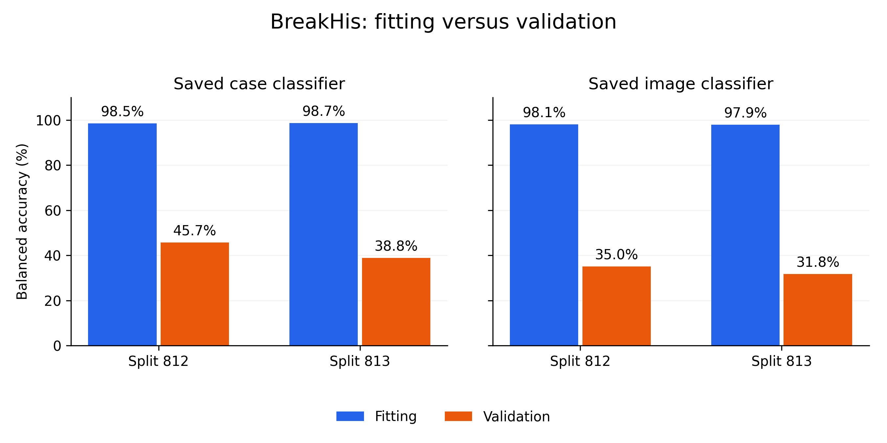

# BreakHis diagnosis: a large fitting–validation gap

November 13, 2026. All ten saved-model diagnoses completed. **The strongest finding is poor transfer from fitting cases to validation cases under the existing provider-case splits.** No model was trained or selected in this analysis.

In plain language: the model answers practice cases very well, but struggles with the cases left out of each run’s training. Keeping the image classifier or changing these two simple averaging orders does not fix the gap. This is consistent with overfitting/limited generalization; it does not establish one sole cause.

Bars are descriptive five-trial means for each split. The panels have different prediction units; the image panel also equalizes case/zoom influence. Repeated trials are not independent clinical replications.

## Saved adapted case classifier

Balanced accuracy gives every subtype equal importance. Fitting contains 46 cases with unequal class counts; validation contains eight cases, one per subtype. Scores average all 15 view subsets.

| Split | Fitting balanced accuracy | Validation balanced accuracy | Validation macroF1 |
| --- | ---: | ---: | ---: |
| 812 | 98.5% | 45.7% | 0.3840 |
| 813 | 98.7% | 38.8% | 0.3205 |

## Saved auxiliary image classifier

These are canonical, unaugmented cached pictures, with dropout disabled. Class/case/view-balanced field weights match expected training sampling mass. The field target is the inherited provider-case label, not an independently annotated diagnostic region.

| Split | Fitting weighted accuracy | Validation weighted accuracy | Fitting weighted CE | Validation weighted CE | Raw fitting /validation image accuracy |
| --- | ---: | ---: | ---: | ---: | ---: |
| 812 | 98.1% | 35.0% | 0.100 | 3.022 | 95.4% / 28.6% |
| 813 | 97.9% | 31.8% | 0.105 | 2.865 | 94.7% / 30.7% |

These evaluation losses differ from augmented/dropout-on minibatch training loss. Validation weighted CE is worse than the analytic uniform eight-class probability reference, ln(8)≈2.079. Accuracy and confidence quality describe different failures. No calibration model is fitted.

## All fixed case readouts

Every readout uses the same allowed cases and all 15 subsets. No winner is selected from these diagnostic probes.

| Split | Saved readout | Fitting balanced accuracy | Validation balanced accuracy | Validation F1 | All-view validation accuracy |
| --- | --- | ---: | ---: | ---: | ---: |
| 812 | Frozen logistic case head | 98.3% | 45.7% | 0.3843 | 47.5% |
| 812 | Adapted logistic case head | 98.5% | 45.7% | 0.3840 | 47.5% |
| 812 | Auxiliary head, mean logits | 99.8% | 41.5% | 0.3326 | 40.0% |
| 812 | Auxiliary head, mean probabilities | 99.8% | 41.7% | 0.3356 | 42.5% |
| 813 | Frozen logistic case head | 98.4% | 38.3% | 0.3169 | 37.5% |
| 813 | Adapted logistic case head | 98.7% | 38.8% | 0.3205 | 40.0% |
| 813 | Auxiliary head, mean logits | 99.8% | 38.7% | 0.2995 | 37.5% |
| 813 | Auxiliary head, mean probabilities | 99.8% | 39.0% | 0.3033 | 37.5% |

The auxiliary case averages do not provide a consistent rescue. Both saved image-level and case-level classifiers show a large fit–validation gap. Case aggregation has higher validation accuracy than the individual-field score here, but this is a descriptive change of prediction unit, not proof of a causal benefit.

For a linear head, averaging features before classification equals averaging logits after classification. The executed identity check passed. Consequently, these results do not establish that early averaging alone discarded a recoverable signal. Probability averaging is nonlinear, but these fixed probes remain weak.

## Subtype recall of the adapted case classifier

| Subtype | Fit812 | Validation812 | Fit813 | Validation813 |
| --- | ---: | ---: | ---: | ---: |
| adenosis | 100.0% | 60.0% | 100.0% | 60.0% |
| ductal carcinoma | 94.5% | 80.0% | 95.0% | 90.7% |
| fibroadenoma | 95.1% | 34.7% | 94.7% | 32.0% |
| lobular carcinoma | 100.0% | 57.3% | 100.0% | 58.7% |
| mucinous carcinoma | 98.1% | 77.3% | 99.7% | 48.0% |
| papillary carcinoma | 100.0% | 13.3% | 100.0% | 4.0% |
| phyllodes tumor | 100.0% | 0.0% | 100.0% | 0.0% |
| tubular adenoma | 100.0% | 42.7% | 100.0% | 17.3% |

Phyllodes and adenosis each have one fitting provider case per run. Phyllodes fits perfectly at the case level yet has 0 validation recall. Repeated fields do not supply new independent disease examples. Papillary validation recall also remains weak. These observations implicate limited generalization, not a proven biological/labeling explanation.

## Feature geometry

| Split | Validation raw-field cosine | Validation raw relative L2 | Validation standardized view-mean cosine | Validation standardized relative L2 |
| --- | ---: | ---: | ---: | ---: |
| 812 | 0.99840 | 0.08232 | 0.99659 | 0.07802 |
| 813 | 0.99839 | 0.08244 | 0.99613 | 0.08186 |

All geometry comparisons had valid mass 1. The directions remain similar; a cosine near1 is not a percentage of identical features and does not prove that classifier margins are unchanged. Standardized means use each head’s own saved fitting-only normalizer. Geometry does not isolate a cause of classification failure.

## Verification and scope

CPU job 4968029 completed successfully in 70 seconds, using two CPU cores and no GPU. There were zero new fits, encoder forwards, raw-image decoding or outer predictions. Immutable diagnosis source `23a8132cca1d2068ae76eee5f6812234ab235cd0`; input comparison SHA256 `c26398dcfbeac6ac76f737ab686a987f82c2ea6874a45132fe9a0a7fc8b5637b`. Private diagnosis SHA256 `9e397afa96f98dec67e62d9e7a3179cfc61b4589f4ff5228d00f8e0ea04630b0`.

Maximum archive replay error1.44e-15; auxiliary Torch probability error5.68e-07; affine-pooling logit error7.11e-15.

The independent reviewer recomputes scores, role/path/label weights, both auxiliary case readouts and aggregate arithmetic from saved records. Raw geometry vectors remain on the cluster, so local geometry review checks provenance/bounds/summary arithmetic rather than independently redoing cosine/L2. [Independent review](reviews/BREAKHIS_DIAGNOSIS_REVIEW.md) · [Public aggregate/hash ledger](evidence/BREAKHIS_DIAGNOSIS_RESULTS.json) · [Fixed diagnostic specification](BREAKHIS_DIAGNOSIS_SPEC.md).

## Decision and next work

Retain the frozen baseline. The failed adaptation gate is unchanged; do not repeat this recipe for more epochs or choose a diagnostic winner. Before another registered training round, audit split/class coverage and define a compatible supervised image-model baseline with the same roles, class-aware weighting, case readout and 15-subset metrics. A smaller end-to-end supervised reference is a hypothesis to test, not a promised fix.

Stay on BreakHis. All 82 provider cases have entered development somewhere; only 31 distinct validation cases recur across these arrangements, and clinical identifier relationships remain unresolved. This diagnosis is posthoc on reused development cases, not a fresh clinical test, significance claim, novelty result or a finished conference paper.
