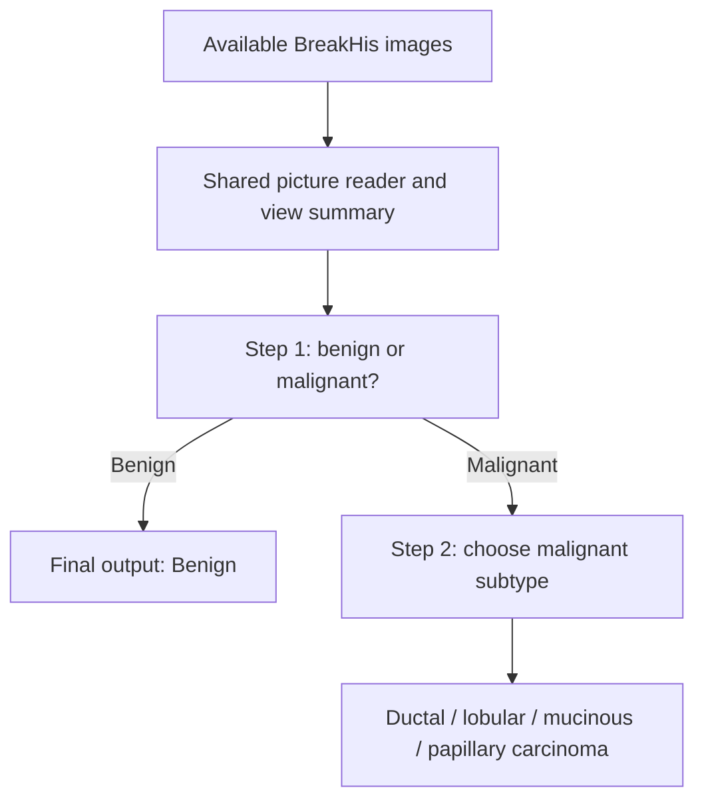

# BreakHis: confirmed two-step, five-category target

November 15, 2026. **Latest user correction supersedes the earlier eight-type hierarchy choice:** the final labels are one pooled benign category and four malignant subtypes. Step1 predicts benign/malignant; benign stops, malignant proceeds to Step2. There is no benign subtype classifier.

Only BreakHis supplies fitting/evaluation images and labels for this capstone. Earlier TCGA experiments remain separate and deferred. Pretrained weights learned on other data are transfer learning; this does not mix those images into current BreakHis fitting or validation.

## Confirmed decision chain

The five final labels are **benign, ductal carcinoma, lobular carcinoma, mucinous carcinoma and papillary carcinoma**. BreakHis adenosis, fibroadenoma, phyllodes tumor and tubular adenoma map to the pooled benign label. This is the dataset's grouping.

There are **two classifier heads in total**: a binary router and a four-class malignant specialist. A benign example stops after the first decision; a predicted malignant example receives both decisions. During fitting, Step1 learns from fitting cases in both groups; Step2 learns only from fitting cases whose true labels are malignant. Do not train the malignant specialist on incorrectly routed validation examples.

The original paper uses pretrained ResNet-50 features, binary XGBoost, then malignant-four-class XGBoost. This correction matches its label hierarchy. A Phikon-based multiview implementation would still differ in encoder, input unit, fusion and protocol; matching the hierarchy alone is not exact paper reproduction or new-method evidence.

## Three systems and their existing scores

| System | Prediction task | Architecture | Recorded accuracy |
| --- | --- | --- | --- |
| Supplied notebooks | Eight types, one40× image | Trainable ImageNet EfficientNetV2B0; non-local attention or spatial ConvLSTM gate; global average pooling; Dense64/ReLU; Dense8/softmax | Historical saved93.73%/94.99%; not independently retrained |
| Current retained baseline | Eight types, one provider case across available zooms | Frozen Phikon-v2; within-zoom means; fitting-only normalization; available-zoom mean plus four flags; eight-class logistic head | Mean15-subset validation45.7%/38.3% |
| User-confirmed next target | Benign plus four malignant types | Shared representation; binary router; malignant-four-class specialist | **Not implemented/trained/evaluated yet** |

The notebook pair represents two models. Current pairs represent two existing validation arrangements812/813, each averaged across five overlapping trials and15 view combinations. The current87.0%/80.7% benign/malignant result sums saved eight-class probabilities; it is a retrospective secondary result, not five-class accuracy or trained dual-step performance. The paper's86.22% is author-reported binary image accuracy under another protocol, not five-class accuracy.

## What final accuracy must count

A benign case is correct only when Step1 returns benign. A malignant case is correct only when Step1 returns malignant **and** Step2 names its correct malignant subtype. Count wrong routing and wrong subtype as errors in end-to-end five-class accuracy.

Hard routing means a wrong first group cannot be recovered by Step2. Final five-class accuracy therefore cannot exceed binary-router accuracy on the same examples/view settings. Reusing current binary decisions unchanged would bound it by87.0%/80.7% on the existing averaged endpoint, even with perfect malignant typing. This is a bound on that reuse, not a prediction for a new router.94–95% overall needs sufficiently strong routing and malignant typing.

Report end-to-end five-class accuracy, five-class macro F1/balanced accuracy, all-five class recall/confusion, binary accuracy/sensitivity/specificity and malignant subtype performance. Specialist accuracy given the correct true group is diagnostic, not whole-system accuracy. Keep full-four-view and mean15-subset results distinct.

Preserving the old roles gives four benign cases and one case for each malignant type in each eight-case validation set. Thus pooled benign has50% of validation support and each malignant label12.5%. Unlike the old eight-class validation, raw accuracy and balanced accuracy are no longer automatically equal. An always-benign answer achieves50% raw accuracy, while five-class balanced accuracy is20%. Report class-balanced measures as well as accuracy; do not present pooling labels as an architecture improvement.

## Before versus current evaluation

Original notebooks use1,596 fitting and399 evaluation images, all40×. They split images by subtype rather than enforce provider-case isolation. The same399 images guide checkpoint/learning-rate selection and supply the reported score:374/399 and379/399 correct. Exact historical overlap cannot be reconstructed.

Completed case studies use46 fitting/eight validation/28 excluded provider cases, five overlapping trials and arrangements812/813. They predict a case from multiple fields, averaged across all15 nonempty zoom subsets. Eight-class accuracy is45.7%/38.3%; all-four-view-only accuracy is47.5%/37.5%. These remain eight-class historical baseline results after the task correction; they are not relabeled five-class results.

There are31 distinct validation cases across arrangements. Clinical identity relationships remain unresolved; all82 provider keys entered development somewhere and no globally pristine BreakHis confirmation cohort remains. Existing values are exploratory provider-case validation, not a final independent clinical test.

## Next bounded comparison

Preserve completed baseline artifacts. Register a full recipe for a **direct five-class control versus the requested binary-plus-malignant-four pipeline**, with the same BreakHis cases, representation, input unit, roles, zoom subsets and declared selection opportunities. A separately labeled fixed collapse of existing eight-class outputs may provide an additional retrospective five-class diagnostic; it is not a newly trained direct-five control or dual-step result.

Lock normalization, class/case weighting, encoder choice, optimization, routing threshold, probability reporting, selection metric and fit budget before new outcomes. First compare the decision structures with a shared representation; backbone changes require separately declared experiments. Preserve both arrangements/all trials and negative outcomes. Do not resplit or use excluded-case outcomes to chase94–95%.

94–95% remains the user's goal, not an achieved or guaranteed result. The correction changes the requested target and future scorecard; it changes no saved result. No new model fitting, inference, split change or cluster training job was performed while making this correction.

[Original/current evidence](CAPSTONE_BEFORE_AND_NOW.md) · [Independent notebook/paper review](reviews/CAPSTONE_ORIGINAL_RESULTS_REVIEW.md) · [Current baseline training](TRAINING_STRATEGY.md) · [Binary secondary results](CAPSTONE_BINARY_RESULTS.md).
