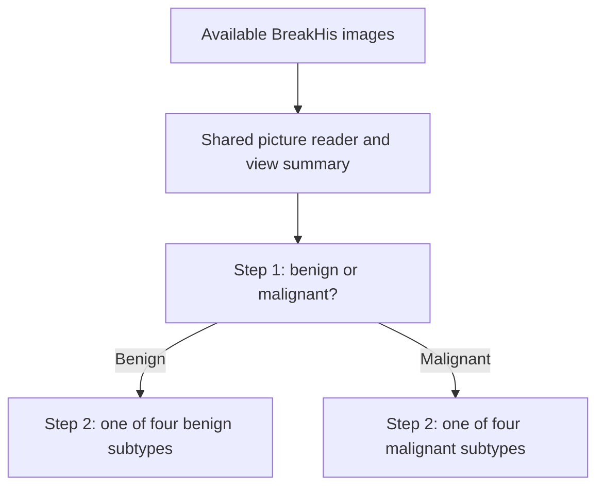

# BreakHis: confirmed two-step, eight-type target

November 15, 2026. The user confirmed: **keep all eight types with two-step decisions**. BreakHis is the only dataset for the current capstone's fitting and evaluation. Earlier TCGA experiments remain separate and deferred. Pretrained weights learned on outside data are transfer learning; no TCGA images/labels are mixed into this BreakHis fitting or validation.

## Three different systems

| System | What it predicts | Architecture | Measured accuracy |
| --- | --- | --- | --- |
| Supplied notebooks | One of eight types for one40× image | Trainable ImageNet EfficientNetV2B0, either non-local attention or spatial ConvLSTM gate, global average pooling, Dense64/ReLU, Dense8/softmax | Historical saved93.73%/94.99%; not independently retrained |
| Current retained baseline | One of eight types for a provider case across available zooms | Frozen Phikon-v2, within-zoom means, fitting-only normalization, available-zoom mean plus four flags, eight-class logistic head | Mean15-subset validation45.7%/38.3% |
| User-confirmed target | Benign/malignant first; then one of four types in that group | Shared image/view representation, one binary router and two group-specific four-class experts | **Not implemented/trained/evaluated yet** |

The notebook pair represents two model variants. Current result pairs represent two existing validation arrangements812/813, each averaged over five overlapping trials and15 view combinations. No final independent test accuracy is available.

The supplied published dual-step paper is another system: pretrained ResNet-50 features, binary XGBoost, then a malignant-only four-class XGBoost. It pools all benign types into one final label and therefore returns five labels. Its86.22% is binary image accuracy under another protocol. The user's confirmed eight-type target adds a benign subtype expert and is an adaptation, not an exact reproduction or a new mechanism claim.

## The confirmed decision chain

| BreakHis group | Four final subtype labels |
| --- | --- |
| Benign | Adenosis; fibroadenoma; phyllodes tumor; tubular adenoma |
| Malignant | Ductal carcinoma; lobular carcinoma; mucinous carcinoma; papillary carcinoma |

This has **two decisions per input and three classifier heads in total**: one router and two specialists. Only the chosen specialist determines the hard final answer. The grouping is the dataset's label definition.

During training, the router learns broad labels from fitting cases. Each specialist learns subtype labels from fitting cases in its true group. Validation cases must not fit normalization, weights or calibration. The eventual encoder, optimization, regularization, routing threshold, probability composition and tuning budget still require a complete registered experiment recipe; they are not locked by this architecture note.

## What the existing binary result means

Current baseline computes eight probabilities directly, then sums four malignant probabilities and thresholds at0.5. Its87.0%/80.7% binary accuracy is a retrospective secondary analysis of existing outputs, not the result of a trained two-step classifier. Neither the supplied notebooks nor the current retained baseline implements the newly requested decision hierarchy.

With hard routing, a wrong first group makes a correct final subtype impossible. Consequently end-to-end eight-class accuracy cannot exceed router accuracy on the same examples/view settings. Reusing the existing binary decisions unchanged would bound final accuracy by87.0%/80.7% on the existing averaged endpoint, even with perfect specialists. This is a mathematical bound on that reuse, not a prediction for a newly trained router. Both the router and subtype experts need strong generalization to reach94–95% overall.

## How accuracy was measured before and now

Original notebooks use1,596 fitting images and399 evaluation images, all40×. The code randomly separates images by subtype, not provider case. The same399 images guide learning-rate changes/checkpoint selection and supply the reported score. Correct counts are374/399 and379/399. Exact historical case overlap cannot be reconstructed from supplied artifacts.

Current baseline uses46 fitting/eight validation/28 excluded provider cases per run, with one validation case per subtype. It predicts a case from multiple fields rather than one field. Five overlapping trials are reported under both arrangements. All15 nonempty zoom combinations receive equal averaging weight; each case within a setting is one prediction. Accuracy is the fraction correct; primary macro F1 gives each subtype equal importance. Current all-four-view accuracy alone is47.5%/37.5%, separately from mean15-subset45.7%/38.3%.

Clinical identity relationships remain unresolved. There are31 distinct validation cases across arrangements; repeated masks/trials are not new patients. All82 provider keys entered development somewhere; no globally pristine BreakHis confirmation cohort remains. These are exploratory provider-case validation results.

## Next experiment and94–95% goal

Preserve all completed baseline results and capstone materials. Before any new fit, specify one bounded, complete hierarchy recipe and compare it with the direct eight-class control using the same data, grouping, input unit, roles, magnifications and declared selection opportunities. First use a shared representation to isolate the decision structure; any subsequent encoder fine-tuning is a separately declared experiment.

Report final eight-class accuracy and macro F1, broad-group accuracy/sensitivity/specificity, all-eight subtype recall/confusion, full-view and all15-subset scores. Specialist performance given the correct group is diagnostic and cannot replace end-to-end accuracy. Count routing errors in the final score. Preserve both arrangements/all trials and all negative outcomes; no score-driven resplit or outer-case rescue.

94–95% is the user's performance goal, **not an achieved or guaranteed result**. It must name the exact task and evaluation protocol. This note changes the requested target architecture, not any saved metric or previously registered result. Current turn is explanation/design clarification; no new training, inference, split change or cluster job has been performed.

[Original/current evidence](CAPSTONE_BEFORE_AND_NOW.md) · [Independent notebook review](reviews/CAPSTONE_ORIGINAL_RESULTS_REVIEW.md) · [Current training](TRAINING_STRATEGY.md) · [Binary secondary results](CAPSTONE_BINARY_RESULTS.md).
