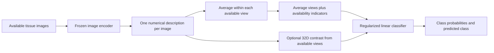

# MagSet-Histo in plain language

**Current priority:** BreakHis is the main dataset. Finish the [quick project baseline](BREAKHIS_MILESTONE_PLAN.md) first. TCGA and novel-paper follow-up below are deferred research records. The [BreakHis first-results page](BREAKHIS_FIRST_RESULTS.md) is the current deliverable.

Updated November 12, 2026. This explains the actual experiments and distinguishes them from proposals. The repository name is a working name; the latest pilot uses a linear classifier rather than a transformer.

## 1. What problem are we solving?

A microscope gives different clues at different zooms. A wide view shows tissue structure; a close view shows finer detail. We want to combine the available views of one tissue case and predict its class, even when some views are unavailable.

The original task is **eight breast-tumor subtypes**. The research question is whether agreement between views helps beyond a strong average. The secondary dataset asks a broader 16-class tissue question with a separate classifier. It does not independently confirm the same eight-class breast classifier.

## 2. What are the datasets and splits?

| Item | BreakHis development experiments | TCGA-MS latest development pilot |
| --- | --- | --- |
| Images used |7,909|37,024 selected from 65,312 decoded release images|
| Views |40×,100×,200×,400×|0.25,0.5,1.0,2.0 microns per pixel|
| Grouping |82 subtype-qualified provider cases|128 supplied patient IDs, one slide each|
| Classes |8 breast-tumor subtypes|16 source-defined tissue classes across several organs|
| Fitting |46 cases per repeated trial|80 patients,5 per class|
| Validation/development |8 per trial,1 per subtype|16 patients,1 per class|
| Outer/reserved role |28 per trial|32 patients,2 per class|

BreakHis uses **five overlapping repeated holdouts**, not disjoint five-fold cross-validation. Each provider trial starts with 54 training and 28 outer-role cases. One case per subtype is selected from those 54 for validation, leaving 46 for fitting. Inner seeds 812 and 813 were checked. Outer outcomes were not scored; however, every one of the 82 cases has entered fitting or validation in some trial. There is no globally fresh BreakHis confirmation set after that development history.

The clinical relationships between some provider identifiers remain unverified. We therefore say “provider cases,” not independently verified patients. The older notebooks' image-based splits and high saved accuracies do not establish unseen-patient performance.

TCGA roles were registered before any native classifier fitting. All related fields/resolutions stay together. Six patients missing the 0.25-mpp view are fitting-only. Development and reserved patients have all four views. The reserved group is excluded from classifier fitting, normalization, tuning, and current prediction. Its public labels are procedurally quarantined, not encrypted.

Microns per pixel measures physical image resolution: a smaller number is finer detail. We do not equate these values directly to BreakHis objective-magnification labels. TCGA-MS is multi-organ; only 32 of its 128 patients are breast-labeled. BRACS access is not approved. The exact secondary class IDs and observed descriptions are recorded in [the native label schema](NATIVE_LABEL_SCHEMA.md); some source groups contain several histology descriptions, so we preserve source targets rather than infer new labels.

## 3. What goes in and comes out?

**Input:** several tissue images from one case, grouped by available zoom. Different zooms can have different numbers of fields. We do not assume that image number 1 at one zoom physically matches image number 1 at another.

**Output:** a probability vector and its highest-scoring class:8 probabilities for BreakHis,16 for the native TCGA task. The probabilities sum to one; this alone does not make them well calibrated or clinically reliable. The current experiments make a case-level prediction, not one independent prediction per field.

BreakHis classes: adenosis, fibroadenoma, phyllodes tumor, tubular adenoma, ductal carcinoma, lobular carcinoma, mucinous carcinoma, and papillary carcinoma. The first four listed are benign categories and the last four malignant categories; the main task distinguishes all eight.

## 4. What is the architecture?

An **encoder** is the image reader. Phikon-v 2 produces 1,024 numbers per image; ResNet-50 produces 2,048. These externally pretrained weights remain frozen during the completed fusion experiments. Phikon was pretrained on pathology data and its pinned card includes TCGA-source slides; exact overlap with this release is unresolved. The native pilot uses the ImageNet-pretrained ResNet control.

The **fusion** stage combines those descriptions. Completed BreakHis controls include averaging, concatenation, late probability averaging, learned gates, and hierarchical field/view attention. In the native pilot, the baseline has 2,048 averaged numbers plus 4 view-availability indicators. The other three arms append 32 numbers, making 2,084 input features.

The **classifier** learns how those numbers relate to labels. A multinomial logistic classifier learns one score per class and converts scores to probabilities using softmax. It is a small trained head; we are not currently training the whole ResNet or a large foundation model from scratch.

## 5. How does training work?

1. Encode images once with the fixed pretrained encoder and save checked feature caches.
2. Learn per-view normalization from fitting cases only, giving each case equal influence regardless of how many fields it has.
3. Show every nonempty combination of actually available views. Four views give 15 combinations; three give 7. These are augmentations of the same case, not new independent patients.
4. Give each case total training weight 1 across its combinations. Every native class therefore has fitting weight 5. No extra row-based class balancing is applied.
5. Fit the classifier by minimizing weighted cross-entropy with an L 2 penalty. Cross-entropy penalizes assigning low probability to the correct label; L 2 discourages excessively large coefficients.
6. Evaluate the fixed models on development patients only and retain all outcomes.

The native pilot has exactly four fits, fixed C 0.1, LBFGS, max_iter 1000, projection seed 812, projection dimension 32, and affinity temperature 0.2. There is no hyperparameter grid. Earlier BreakHis pilots used their own documented small grids; their settings are not silently transferred as new searches.

## 6. What is the proposed mechanism?

Keep the reliable average and append a small signed contrast describing how an agreement-weighted summary differs from the ordinary summary. A clue that resembles clues in other available views receives more weight. Comparisons use learned image features, not physical image registration or verified biological matching.

The four arms are:

| Arm | What it tests |
| --- | --- |
| Mean plus mask | Strong simple baseline |
| Mean plus projected duplicate mean | Whether adding redundant features changes effective regularization |
| Mean plus random-partition contrast | Whether any same-sized extra field summary gives a similar benefit |
| Mean plus affinity-agreement contrast | The specific agreement hypothesis |

All three added blocks have 32 features and use the same fixed projection. For random/affinity arms, the extra block is zero with only one view. Baseline features remain present, but jointly fitting additional features can change coefficients and worsen predictions. This is not a nondegradation guarantee, an OT method, or established novelty.

## 7. How do we compare scores?

The main score is **macro F 1 averaged equally across all 15 view combinations**. Macro F 1 balances correct detections and false alarms within each class, then gives every class equal importance. We want the method to help across missing-view patterns, not only when every view is present.

| Reported measure | Plain meaning |
| --- | --- |
| Macro F 1 per subset and mean across 15 | Class-balanced overall performance under availability changes |
| Full-view F 1 | Performance with every view |
| Worst-subset F 1 | Weakest availability setting |
| Accuracy | Fraction of correct case predictions |
| Balanced accuracy | Average class recall |
| Per-class recall/confusion matrix | Which tissue classes are missed or confused |
| Multiclass Brier score | Squared probability error; lower is better |
| Coefficient count and feature/fit time | How much added model size and computation a mechanism costs |

Native Brier averages the sum of 16 squared errors per patient. The native development group has one patient per class, so accuracy and balanced accuracy coincide there. Its 240 case/subset rows still represent only 16 independent patients. We do not claim significance or use naive row-level confidence intervals. Final uncertainty must retain patient dependence and be specified before confirmation.

Fair comparisons keep the encoder, images, roles, preprocessing, field policy, tuning budget, and metric fixed. Published binary/image-level accuracies cannot be compared directly to our eight-class case-level macro F 1.

## 8. What have we learned, and what comes next?

The 175 BreakHis configurations are exploratory development runs. In the normalization-matched comparison, linear mean achieved mean-subset F 1 of 0.3843/0.3169 for inner seeds 812/813; the highest checked neural controls achieved 0.3636/0.2744. These values summarize overlapping trial estimates. They are not final test accuracy or 175 independent samples.

The fixed native four-arm pilot has now completed. Mean-subset macro F1 was **0.334028 for mean**, **0.339583 for duplicate mean**, **0.334028 for random contrast**, and **0.338194 for affinity contrast**. The affinity arm does not exceed the duplicate control. It changes only one of240 development decisions relative to mean, involving one patient in one availability setting. This pilot does not support an agreement-specific improvement claim. These are16-class development scores and cannot be ranked directly against the eight-class BreakHis values.

The prespecified decision is to stop the improvement claim for this version and preserve all outcomes. We should review the contribution/data direction with Professor Dong and finish compatible prior-work comparisons before registering another mechanism experiment. The 32 reserved patients remain excluded from scoring. The project still needs a defensible novelty distinction, stronger evidence, and manuscript review before submission.

See [the complete native results](NATIVE_DEVELOPMENT_RESULTS.md) for all15 subsets, Brier values, coefficient counts, execution evidence, and limits.

Exact settings: [pilot specification](NATIVE_DEVELOPMENT_PILOT_SPEC.md). Provenance and split hashes: [registered native protocol](TCGA_QUARANTINE_PROTOCOL.md). Meeting materials: [Professor Dong brief](evidence/PROFESSOR_BRIEF.md).
