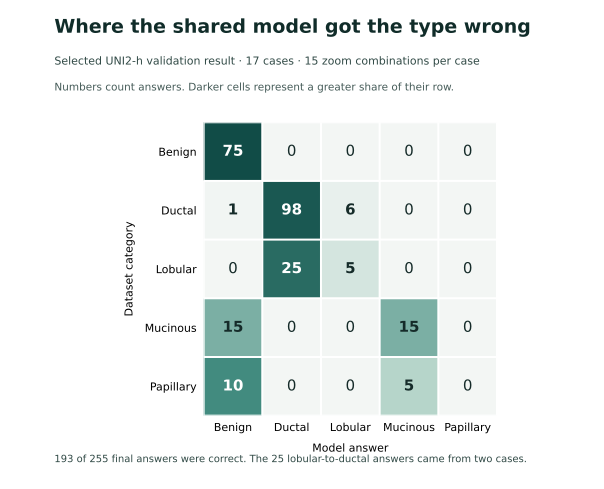

# One model for both BreakHis decisions

The capstone uses one image reader across all four magnifications and one jointly trained classifier for the entire case. A single forward pass produces both decisions. If the case is benign, the answer is complete. If it is malignant, the same network chooses ductal, lobular, mucinous or papillary carcinoma. The objective is greater than 90% correct **final answers** across all 15 available-zoom conditions, with 95% as a stretch objective.

Lang et al. describe a shared ResNet-50 feature extractor and two XGBoost classifiers, a binary first pass and a four-type second pass. Their direct five-way XGBoost classifier is the single-pass comparison. Table 6 gives 86.22% binary accuracy and 57.06% malignant-subtype recall for their dual-step method. They classify individual images. This experiment adopts the decision order and adds the requirement for one jointly fitted classifier per case. [Lang et al., methods and Table 6](https://doi.org/10.1117/12.2582299).

## What we can report to Professor Dong

**The shared UNI2-h model correctly named the final category in 193 of 255 validation answers (75.69%).** Each of the 17 cases was scored under the same 15 zoom combinations. A provider case can contribute 15 similar answers. Five-category accuracy counts benign as correct when the case is benign. For malignant tissue, both the malignant decision and the specific subtype must be correct.

| One jointly trained classifier | Five-category accuracy | Five-category macro F1 | Benign/malignant accuracy |
| --- | ---: | ---: | ---: |
| Shared UNI2-h classifier | **75.69%** | **0.4982** | **89.80%** |
| Swin-Tiny | 59.61% | 0.3933 | 78.82% |
| CNN–Transformer | 59.22% | 0.4842 | 77.65% |

All three rows use the same **17 validation cases**. Macro F1 gives each category equal influence within a zoom condition and is then averaged over the 15 conditions. The shared UNI2-h model has the highest observed accuracy of these three on validation. The original matched evaluation on **16 other, previously used development cases** scored Swin at 59.17% and CNN–Transformer at 56.67% final-five accuracy. The new UNI2-h experiment produced validation predictions only. Its performance on fresh cases is unknown. [Matched validation evidence](evidence/MATCHED_THREE_WAY_VALIDATION.json) · [Earlier 16-case comparison](MATCHED_THREE_WAY_RESULTS.md).

## Where it went wrong

Of 62 incorrect final answers, 26 malignant examples were called benign at the first decision. The other 36 passed the first decision and received the wrong malignant type. This table counts repeated zoom conditions. Only two validation cases were lobular and one was papillary.

| True category | Training cases | Validation cases | Correct final answers across zoom conditions |
| --- | ---: | ---: | ---: |
| Benign | 14 | 5 | 75 / 75 |
| Ductal | 24 | 7 | 98 / 105 |
| Lobular | 2 | 2 | 5 / 30 |
| Mucinous | 5 | 2 | 15 / 30 |
| Papillary | 4 | 1 | 0 / 15 |

The model called lobular tissue ductal in 25 of 30 answers. For the single papillary case it chose benign under ten zoom conditions and mucinous under five. The selected model already classified 671 of 735 fitting answers correctly (91.29%). That gap points to difficulty transferring what it learned to other cases. Whether the sampled fields contain enough distinguishing tissue needs expert inspection. A private review set now contains 84 original fields from 21 training and validation cases, one predetermined field per zoom. It includes every lobular and papillary development case and comparison cases from the other categories. The first review hides the model answers and dataset labels. Expert findings and additional independent rare-type cases are pending.

## Training and verification

| Full-batch update | Correct final answers | Validation accuracy | Mean macro F1 | Binary accuracy |
| --- | ---: | ---: | ---: | ---: |
| **10, selected** | **193 / 255** | **75.69%** | **0.498154** | **89.80%** |
| 20 | 196 / 255 | 76.86% | 0.493000 | 92.55% |
| 30 | 196 / 255 | 76.86% | 0.474455 | 92.94% |
| 40 | 196 / 255 | 76.86% | 0.473242 | 93.33% |

The predeclared macro F1 rule selected update 10. With all four views available simultaneously, that model got 13 of 17 cases right (76.47%). Greater than 90% on the primary validation endpoint would have required 230 correct answers, 37 more than observed. An independent implementation rebuilt the selected network from its saved weights and matched all 255 predictions. It also recalculated all four checkpoints' scores and verified the selection. Slurm job 4987809 completed successfully in 17 seconds, using the existing frozen field descriptions and fitting 49,477 parameters. [Run and per-class results](evidence/BREAKHIS_SHARED_HIERARCHY_VALIDATION.json) · [Independent replay](evidence/BREAKHIS_SHARED_HIERARCHY_REPLAY.json) · [Recalculation code](../scripts/check_shared_hierarchy.py).

## Fixed experiment

- Use BreakHis only. Reuse the audited 49 training cases in 42 conservative groups and 17 validation cases in 15 groups. The 16 remaining cases already appeared in prior project evaluations. This experiment is a development comparison on validation.
- One frozen UNI2-h reader has already described each original field from its center crop. Average the field descriptions within each magnification. Standardize each view using training cases. Average only the available standardized views, normalize that vector to length one, multiply by the square root of its width, and append four availability flags.
- Use one shared 32-unit hidden layer, GELU activation, dropout of 0.2 and one five-number output layer. Its first number gives the malignant score. Its other four numbers rank malignant subtypes. A nonnegative first score routes to malignant, where the largest of the four scores names the type.
- Fit everything trainable together with one AdamW optimizer. Use a class-balanced binary loss on every training case and a class-balanced subtype loss on malignant cases. Average these two losses equally. Every case appears under exactly 15 masks. All 15 masks share that case's labels.
- Fix seed 812, learning rate 0.001 and weight decay 0.01. Run 40 full-batch updates. At updates 10, 20, 30 and 40 compute the mean of the 15 five-category macro F1 scores on validation. Save the first maximum. This selection rule gives each subtype a say even when ductal cases are more common. Report all four checkpoints, the selected final-five and binary accuracy, class recalls, and the all-four-zoom result separately.
- For a matched validation reference use the previously selected dual-head CNN–Transformer and Swin on the same 17 cases and zoom masks. The pipelines differ in pretraining and image cropping. The scores compare complete systems. No additional encoder, threshold, seed, split or checkpoint search is part of this experiment.

In an earlier experiment H combined a Midnight reader for the first decision with a UNI2-h reader for the second. Its observed 82.92% on the reused 16 cases is a historical two-reader result. The earlier matched CNN–Transformer and Swin each used one jointly trained model. [Matched comparison](MATCHED_THREE_WAY_RESULTS.md) · [Historical specialist results](DEEP_DIAGNOSIS_AND_PROOF.md).
