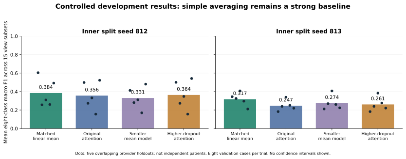

# MagSet-Histo: evidence for Professor Dong

Prepared November 12, 2026. Working preparation target: November 18; the meeting date is not confirmed. This is a progress and decision package, not a claim of a completed novel paper.

## The project in plain language

A tissue sample looks different when the microscope zoom changes. We want a model to combine the available views and classify the tissue, even if a view is missing. The first task uses all four BreakHis magnifications and eight tumor subtypes.

## From the beginning to now

1. Reviewed the six supplied files. The historical 40x notebooks reported high image accuracy, but their split/model-selection procedure did not establish generalization to unseen patients.
2. Obtained and checked 7,909 BreakHis images at 40x/100x/200x/400x. Built reproducible manifests, pinned encoders, frozen feature caches, scheduler jobs, and saved predictions.
3. Completed 175 development configurations, including averaging, concatenation, late fusion, field aggregation, gates, attention, two validation splits, and capacity/dropout checks.
4. Found that matched linear averaging remains ahead of the checked neural controls on both inner splits. These are noisy validation findings, not final test performance.
5. Ran three critique agents in two rounds: six review artifacts. Added trusted label/split checks and verified all 175 saved sets. The same data still contain only 31 distinct validation provider cases; the number of runs is not the sample size.
6. Downloaded and decoded 65,312 TCGA-MS images. Registered a new secondary 16-class task with 80 fit, 16 development, and32 reserved patients before classifier training. Frozen ImageNet features have now been created for 37,024 selected images; no classifier fitting or reserved-patient scoring has occurred.

## Evidence we can show now

| Checked inner split | Matched linear mean F1 | Highest neural-control mean F1 |
| --- | ---: | ---: |
|812|0.3843|0.3636|
|813|0.3169|0.2744|

All values average 15 availability subsets over five overlapping provider holdouts, with eight validation cases per trial. They are macro F1, not accuracy. Input cases, encoder caches, and actual saved normalization arrays were matched. Every saved probability set was checked against trusted labels, regenerated split membership, and its reported arithmetic.

## What the critiques changed

- **BreakHis identity:** provider cases are disjoint within a trial, but conservative numeric stems can cross roles. Their clinical meaning is unverified. A strict three-way class-covered stem split is infeasible with only two adenosis stems.
- **Confirmation wording:** all82 provider cases have entered fitting or validation somewhere across development. We have not scored outer-role predictions; we do not have a globally pristine BreakHis confirmation cohort.
- **Encoder provenance:** Phikon-v2 pretraining includes TCGA. Exact slide overlap is unknown. TCGA is a secondary multi-organ task, not contamination-free external validation of the breast classifier. Frozen ImageNet ResNet is the first provenance control.
- **Novelty:** multiscale attention, missing masks, shared/specific features, and partial transport already have prior art. Splitting a mean into matched/unmatched parts does not create new information.

## Proposed contribution: a falsifiable hypothesis

Keep the strong mean features and add a small, fixed 32-dimensional summary of cross-view agreement. Fit a regularized linear head rather than another large transformer. Ask whether the agreement summary improves missing-view classification beyond equally sized extra-feature controls.

The necessary controls are: mean alone, duplicated mean, within-bag variation, random partition, and simple cross-view affinity. Partial transport is optional only if cheaper agreement controls leave an unexplained benefit. This is a proposal; no method result or novelty proof is claimed.

**Go:** benefit survives the declared protocol, exceeds equal-dimension controls, and does not depend on one selected split. **No-go:** random/duplicate controls explain the effect, identity sensitivity removes it, or the second task contradicts it. Report negative evidence and narrow the contribution if necessary.

## Working plan to November 18

|When|Deliverable / gate|
|---|---|
|Nov12|Trusted 175-run audit, six critiques, registered 80/16/32 protocol, evidence packet|
|Nov13-14|Verify frozen ImageNet caches; freeze a minimal native baseline budget and metric policy|
|Nov15-16|Algebra/invariance tests and the smallest candidate plus decisive control, if validity gates pass|
|Nov17|Consolidated findings, failure examples chosen by a stated rule, limitations and go/no-go|
|Nov18 target|Review evidence and choose contribution/data/protocol direction with Professor Dong|

This is a working sequence, not a booked meeting or guarantee of a positive result. No author/conference messages or submissions have been sent. No BRACS access is currently approved.

## Decisions for Professor Dong

1. How should uncertain BreakHis case identities be handled in the final scientific claim?
2. Should the main contribution be a narrow method hypothesis, a rigorous benchmark/robustness study, or a different task?
3. Can an independent breast cohort such as BRACS be obtained through approved access?
4. What evidence and venue scope would justify moving to final confirmation?

## Evidence links and limits

- [Matched baseline report](../CAPACITY_RESULTS.md), [split sensitivity](../SENSITIVITY_RESULTS.md), [comparison contract](../COMPARISON_PLAN.md).
- [Registered TCGA quarantine](../TCGA_QUARANTINE_PROTOCOL.md), [dataset audit](../TCGA_MS_AUDIT.md).
- [Validity critique](../reviews/VALIDITY_CRITIQUE.md), [novelty critique](../reviews/NOVELTY_CRITIQUE.md), [data provenance critique](../reviews/DATA_PROVENANCE_CRITIQUE.md).
- [Integrity follow-up](../reviews/INTEGRITY_FOLLOWUP.md), [protocol follow-up](../reviews/PROTOCOL_FOLLOWUP.md), [anticipated meeting questions](../reviews/MEETING_CLAIMS_FOLLOWUP.md).
- [Pinned Phikon-v2 card](https://huggingface.co/owkin/phikon-v2/blob/2ae989a9c40cffaa27f0a6cb29cc94d1d6f9a5fd/README.md), [MagViT](https://arxiv.org/html/2608.16959v1), [M2OTCA](https://doi.org/10.1016/j.media.2026.104082).

Trusted result-ledger SHA256:`c8c757097118d572a106ddbf4ff5d3f5747737c7db36c0b374a4c4a292e5cadb`. Native manifest SHA256:`a668cf85151f29a163628210851c007faaf8c9679b7c9f5eaadc8c031f06e27b`. Test scoring, independent clinical generalization, and a submission-ready novel paper remain unfinished. Review agents are diagnostic aids, not scientific certification.
